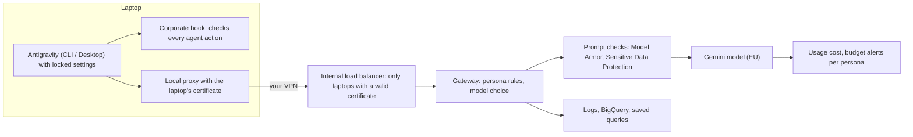

# How the POC works

A plain-language tour of the parts of the POC: what each part does, what the user notices, and where it is configured. To change a setting, see [POC-CHANGING-SETTINGS.md](POC-CHANGING-SETTINGS.md); to run the POC, [POC-STEP-BY-STEP.md](POC-STEP-BY-STEP.md).

## On the laptop

### Antigravity and locked settings
- **What it does:** the install script puts a pinned version of Antigravity on the laptop (Windows: CLI and Desktop app; Mac: CLI) and locks its settings, so the agent always talks to the corporate gateway and keeps human review on.
- **What the user notices:** Antigravity starts with the corporate settings; the user can't change them. It only runs for the device owner, not for administrators or other users.
- **Where it is configured:** the persona settings files in the repository (`vm/files/policies/`), copied into each kit.

### Corporate hook
- **What it does:** checks every action the agent wants to take (commands, file reads and writes, tools) before it runs. It blocks access to secrets (SSH keys, `.env` files, cloud credentials, browser passwords), uploads to external hosts, downloaded scripts run in a shell, destructive deletes, unapproved tools, changes to its own controls, and sessions that skip human review.
- **Personas:** contractors get more blocks (no web search, URL reading or browser tools, no `curl` / `wget`, stricter file rules).
- **Audit vs enforce:** in week 1 a few rule groups (destructive commands, some workspace commands and file writes) only log instead of blocking. The critical rules (secrets, protected paths, remote scripts, review bypass) always block.
- **What the user notices:** a blocked action shows "Blocked by corporate policy" with a reason in the conversation.
- **Where it is configured:** the hook policy files (`vm/files/hooks/policy.json` for Macs, `windows/files/hooks/policy.windows.json` for Windows), copied into each kit.

### Local proxy and the laptop certificate
- **What it does:** Antigravity sends its model calls to a small proxy on the laptop (`127.0.0.1:8443`). The proxy checks that the caller is the device owner, waits until the locked settings are in place, and forwards the call over the VPN with the laptop's certificate. The certificate's private key is readable only by the system (SYSTEM / Administrators on Windows, root on Mac).
- **What the user notices:** nothing, except right after the first sign-in: "AGY policy not applied yet … try again" for up to a minute.
- **Where it is configured:** the certificate comes from the kit; it lasts 30 days.

### Local groups
- **What it does:** Windows has the local groups `AGY-Dev` and `AGY-Contractor`; Macs `agy-dev` and `agy-contractor`. The install script puts the device owner in the group of the kit's persona, which decides the local rules.
- **What the user notices:** nothing (sign out and in once after the install).
- **Where it is configured:** the `persona` column of `devices.csv`.

### Optional layers (Windows)
- **What it does:** application control (AppLocker and WDAC in audit mode) and Sysmon (detailed process logging). Off by default on POC laptops.
- **What the user notices:** with application control on, programs outside approved locations may be blocked.
- **Where it is configured:** the install options `-AppControl` and `-Sysmon`.

### Remote Desktop rule (Windows)
- **What it does:** Remote Desktop stays available to administrators (for remote support) but is denied to the persona groups.
- **What the user notices:** the device owner can't sign in through Remote Desktop.
- **Where it is configured:** set by the install script (`agy-rdp = admins`).

### Shortcuts to direct model endpoints
- **What it does:** the laptop's hosts file sends direct AI endpoints and tunnel services nowhere, so model traffic can only go through the gateway.
- **What the user notices:** other tools on the laptop that use those endpoints stop working during the POC.
- **Where it is configured:** set by the deployment (part of the kit).

## In the cloud

### Certificate authority and internal load balancer
- **What it does:** a private certificate authority issues one certificate per laptop. The internal load balancer, reachable only through your VPN, accepts only connections with a valid certificate from that authority.
- **What the user notices:** nothing; without the VPN, Antigravity can't reach the models.
- **Where it is configured:** created by `poc/poc-gateway.sh`; certificate lifetime 1–30 days (default 30).

### Device registry
- **What it does:** the gateway accepts only laptops listed in `devices.csv` and takes the owner and persona from that list, not from the laptop. A laptop removed from the list is refused at once.
- **Where it is configured:** `poc/devices.csv`, then `poc/poc-gateway.sh --yes`.

### Gateway
- **What it does:** applies the persona rules (`agy-dev`, `agy-contractor`): which models may be used (contractors: Flash only), "Auto" routing to a light or strong model, prompt checks, and logging. It calls Gemini in the EU.
- **Prompt and answer checks:** blocked prompt topics (for example port scanning, credential theft); an AI intent classifier; **Model Armor** (prompt injection, jailbreak, dangerous content, malicious links); **Sensitive Data Protection** (card numbers, IBANs, personal data, credentials): masked for developers, blocked for contractors (PCI scope).
- **What the user notices:** a blocked prompt returns "Blocked by corporate AI policy" with an incident id; masked data appears as placeholders.
- **Where it is configured:** Terraform variables (models per persona, info types, prompt topics), see [POC-CHANGING-SETTINGS.md](POC-CHANGING-SETTINGS.md).

### Logging, BigQuery and saved queries
- **What it does:** every gateway decision (blocked or masked prompts, rejected laptops, model routing) and every model call's token usage land in log buckets and BigQuery (dataset `agy_siem`, views such as `v_gateway_events`, `v_persona_usage`). Five shared saved queries ("AGY - …") show the main evidence.
- **Where it is configured:** created by the deployment; retention in Terraform variables. Laptop events (hook decisions) stay on the laptop in the POC: collect them with `-Collect` / `--collect`.

### Budgets
- **What it does:** one monthly budget alert per persona (`agy-dev-monthly`, `agy-contractor-monthly`) at 50 %, 90 % and 100 %, based on the labels the gateway puts on every model call. Alerts only: spending is not stopped.
- **Where it is configured:** questions 4 and 5 of `poc/poc-gateway.sh`.
