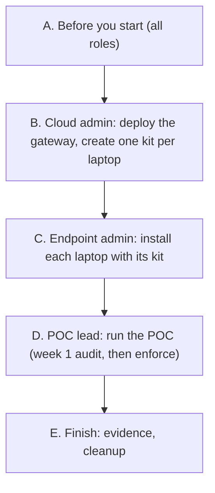

# POC step by step

This guide takes you through the whole POC in order, one role at a time. Each step says **who** does it, **where**, what to **do**, what **you should see**, and what to do **if not**. The details behind each step are in [POC-TECHNICAL-REFERENCE.md](POC-TECHNICAL-REFERENCE.md).



## Names you will see

**Personas.** Each laptop belongs to one persona: `dev` (developer) or `contractor`. Contractors get stricter rules (Flash models only, no web tools). The personas are **not** asked in the 6 questions: you set them per laptop in the file `devices.csv`.

```text
device,owner,persona,os
win-dev-01,developer1@example.com,dev,windows
win-ctr-01,contractor1@example.com,contractor,windows
mac-dev-01,developer2@example.com,dev,macos
```

| Column | Meaning |
|---|---|
| `device` | A free label for the laptop, unique: lowercase letters, digits, `.`, `_`, `-`, 2–63 characters. Use the laptop's short host name in lowercase (a full name like `laptop1.corp.example.com` also works up to 63 characters). It becomes the name on the laptop's certificate; the certificate has no DNS name and nothing depends on domain membership |
| `owner` | The owner's e-mail address. The gateway logs every model call under this name |
| `persona` | `dev` or `contractor` |
| `os` | `windows` (Windows 11), `windows10` (see [POC-WINDOWS-10.md](POC-WINDOWS-10.md)) or `macos` (Linux laptops are not part of the POC yet) |

**Groups.** The same persona appears under three names. They always match, because they all come from the same kit:

| Where | Developer | Contractor | What it does |
|---|---|---|---|
| Gateway (cloud) | `agy-dev` | `agy-contractor` | Which models and checks apply. The gateway knows the persona from `devices.csv` through the laptop's certificate |
| Windows laptop (local group) | `AGY-Dev` | `AGY-Contractor` | Which local rules apply. The install script creates both groups and adds the device owner to the one for the kit's persona |
| Mac (local group) | `agy-dev` | `agy-contractor` | Same, on macOS |

Directory groups (Active Directory or Entra ID) are not used in the POC.

**Device owner.** One owner per laptop: the person who uses Antigravity on it.

| | |
|---|---|
| How it's chosen | The install script proposes the user signed in at the console and asks you to confirm. Or name the owner yourself: Windows `-User laptop-user` (local account), `-User CORP\jdoe` (Active Directory), `-User AzureAD\jdoe@example.com` (Entra ID); Mac `--user jdoe` (short name) |
| Rules | Must be a standard user (administrators are refused). Must have signed in once on the laptop before the install (also directory accounts) |
| Other users | Other accounts on the same laptop can't use Antigravity |

**Cloud resources** (default prefix `agy`; full list in the [reference](POC-TECHNICAL-REFERENCE.md#3-gateway-deployment-what-gets-created)):

| Name | What it is |
|---|---|
| `agy-gateway` | The gateway (Cloud Run service) and its service account |
| `gateway.agy.internal` | The gateway's internal name; laptops reach it over your VPN. Its IP comes from the POC network, or from your subnet with a Shared VPC ([POC-SHARED-VPC.md](POC-SHARED-VPC.md)) |
| `my-poc-project-agy-tfstate` | Installer state (storage bucket), encrypted with key ring `agy-tfstate-ring` |
| `agy-ring-<suffix>` | Encryption keys (KMS key ring) |
| `agy-security`, `agy-audit`, `agy-siem` | Log buckets (security events, audit logs, SIEM) |
| `agy_siem`, `agy_security_events` | BigQuery datasets (views such as `v_persona_usage`, `v_gateway_events`) |
| `agy-dev-monthly`, `agy-contractor-monthly` | Budget alerts per persona |
| "AGY - …" | Saved queries in Log Analytics |

> **What gets created (once):** a gateway with prompt inspection (Model Armor, Sensitive Data Protection), a certificate authority for the laptop certificates, an internal load balancer that only accepts laptops with a valid certificate, private DNS, logging and BigQuery, budgets. Cost: about EUR 75–110 per month plus the model calls (pay per use).

---

## Part A. Before you start

Detailed checklists: [POC-PREREQUISITES.md](POC-PREREQUISITES.md) and [POC-PERMISSIONS.md](POC-PERMISSIONS.md).

| Role | Has ready |
|---|---|
| POC lead | The list of laptops, owners and personas (for `devices.csv`); privacy / works council sign-off; the success criteria agreed with your Google contact before the start |
| Cloud admin | A new Google Cloud project (for example `my-poc-project`) linked to a billing account; Cloud Shell access; a group e-mail for alerts |
| Billing admin | Can add a role on the billing account |
| Network / VPN team | A VPN or Interconnect to the POC network (or a subnet of your Shared VPC, see [POC-SHARED-VPC.md](POC-SHARED-VPC.md)); see the network requirements below |
| Endpoint admin | Local administrator on every laptop; Windows 11 24H2 or later, or macOS 14 or later; on Macs the Command Line Tools (`xcode-select --install`); owners are standard users and have signed in once. Nothing else is needed on Windows: the script installs Python 3.12 and the Antigravity client itself |

---

**Network requirements**

| Need | Detail |
|---|---|
| Laptops → gateway | Only TCP 443 to the gateway IP, over your VPN or Interconnect (also for remote workers) |
| TLS inspection | None on that path |
| DNS | Not needed: the install pins the gateway name in the laptop's hosts file |
| Internet during the install | Windows: `www.python.org` and `storage.googleapis.com` (plus `download.sysinternals.com` only with `-Sysmon`; optional `github.com` for Windows Terminal: if blocked, the install continues with a warning). Mac: `storage.googleapis.com` and the Google-hosted Antigravity CLI release manifest |
| What to give the network team | `poc/poc-gateway.sh --status` prints the gateway IP and port (TCP 443) after step B5 |

## Part B. Cloud admin

**B0. Get the POC repository** (once per person who runs commands below)
- **Who** · cloud admin (and the project admin for B1). **Where** · Cloud Shell.
- **Do** · the repository is private on GitHub: first accept the collaborator invitation (e-mail from GitHub). Then either
  - clone it: `git clone https://github.com/<owner>/antigravity-poc-kit.git && cd antigravity-poc-kit` (GitHub asks for your username and a personal access token with read access; or run `gh auth login` first if `gh` is available), or
  - on GitHub choose **Code → Download ZIP**, upload the file to Cloud Shell (**⋮ → Upload**), then `unzip antigravity-poc-kit-main.zip && cd antigravity-poc-kit-main`.
- **You should see** · a folder with `poc/`, `install/` and `docs/`. Every later Cloud Shell step runs in this folder.
- **If not** · no access: check that the invitation was accepted and the token has read access to the repository.

**B1. Grant the installer role** (once)
- **Who** · project admin. **Where** · Cloud Shell, in the POC repository folder.
- **Do** · `install/grant-installer.sh --project my-poc-project --principal user:installer@example.com --no-evidence`
- **First** the script enables the basic APIs on the project (Cloud Resource Manager, IAM, Service Usage) and waits for them. This needs Service Usage Admin (an Owner has it) and a linked billing account; if it can't, it prints the exact `gcloud services enable … --project my-poc-project` command to run.
- **You should see** · the grant succeeds. It expires on its own after 8 hours: do B4–B6 within that window. Expired? Repeat B1 (safe).
- **If not** · [Cloud permissions](POC-TECHNICAL-REFERENCE.md#2-cloud-permissions-in-detail).

**B2. Give the installer the billing role** (once)
- **Who** · billing admin. **Where** · Google Cloud console.
- **Do** · **Billing → Account management → Add principal** → `installer@example.com` → **Billing Account Costs Manager**.
- **You should see** · the installer listed with that role.
- **If not** · the role must be on the billing account itself, not on the project.

**B3. Wait 5 minutes.** New permissions take a few minutes to work everywhere.

**B4. Write `devices.csv`**
- **Who** · cloud admin, with the POC lead's list. **Where** · Cloud Shell, signed in as the installer.
- **Do** · `cp poc/devices.csv.example poc/devices.csv`, then **edit it**: the example contains 5 sample laptops (`win-dev-01` … `mac-ctr-01`); replace them with your own laptops, owners and personas (see [Names you will see](#names-you-will-see)). Don't keep the sample lines: each line becomes a registered device and a kit.
- **You should see** · `python3 poc/poc_kit.py validate poc/devices.csv` prints no error.
- **If not** · it names the line and the problem; fix and repeat.

**B5. Deploy the gateway and create the kits**
- **Who** · the installer identity (`installer@example.com`): open Cloud Shell signed in as that user. **Where** · Cloud Shell, in the repository folder. Working from your own laptop instead? See [admin laptop setup](POC-TECHNICAL-REFERENCE.md#2-cloud-permissions-in-detail).
- **Do** · `poc/poc-gateway.sh`, then answer the 6 questions (and the optional question 7):

  | Question | Example |
  |---|---|
  | 1. Project ID | `my-poc-project` |
  | 2. Region | `europe-west4` (press Enter) |
  | 3. Admin e-mail for alerts | `agy-poc-admins@example.com` |
  | 4. Monthly budget alert, developers | `2000` |
  | 5. Monthly budget alert, contractors | `1000` |
  | 6. Path to `devices.csv` | `poc/devices.csv` (press Enter) |
  | 7. (optional) Network: `7 Network [1/2] [1]:` | Enter = new VPC in this project (default); `2` = your existing Shared VPC: confirm the detected host project, pick the subnet by number, confirm, then the gateway IP (`auto`) and the region question ([POC-SHARED-VPC.md](POC-SHARED-VPC.md)) |

  Then type `yes` to accept the cost estimate.
- **You should see** · after about 25–30 minutes: `POC gateway ready: https://gateway.agy.internal (internal IP …)` and `Device kits: poc-kit/<device>.tar.gz`.
- **If not** · a permission error at the start: wait a few minutes and run `poc/poc-gateway.sh --yes` (safe to repeat). Preflight `org policy run.managed.requireInvokerIam` FAIL: an organisation policy administrator adds a project exception ([how](POC-TECHNICAL-REFERENCE.md#organisation-policy-runmanagedrequireinvokeriam)). Other errors: [Troubleshooting](POC-TECHNICAL-REFERENCE.md#10-troubleshooting).

**B6. Check**
- **Do** · `poc/poc-gateway.sh --status`
- **You should see** · the gateway, your laptops under "registered devices", the two budgets, and one kit per laptop with about 30 days left.

**B7. Hand the kits to the endpoint admin**
- **Do** · give each laptop its kit: `poc-kit/<device>.zip` for Windows, `poc-kit/<device>.tar.gz` for Macs.
- A kit contains the laptop's private key. Share it through a secure channel (never by e-mail), only with the endpoint admin.

---

## Part C. Endpoint admin

Before each install: the owner has signed in once, and the laptop is on the VPN.

**C1. Windows laptop** (3–6 minutes, no reboot)
- **Where** · the laptop, PowerShell **as administrator**, in the extracted kit folder (for example `C:\AGYKit\win-dev-01`).
- **Do** · run these two lines:
  ```powershell
  Get-ChildItem -Recurse | Unblock-File
  powershell -ExecutionPolicy Bypass -File .\install-windows.ps1 -Install
  ```
  Confirm the proposed owner with `y` (or add `-User <account>`, see [Names you will see](#names-you-will-see)). Not on the VPN yet? Add `-Offline` and test later.
- **You should see** · `installed in <n> min (target < 10, no reboot)`, then a test table and a summary `<n> PASS, <n> WARN, 0 FAIL, <n> SKIP`. **0 FAIL** is what matters (some WARN and SKIP lines are normal in the POC).
- **If not** · [Troubleshooting](POC-TECHNICAL-REFERENCE.md#10-troubleshooting) and [what each check means](POC-TECHNICAL-REFERENCE.md#5-endpoint-install-and-checks).

Test again at any time: `powershell -ExecutionPolicy Bypass -File .\install-windows.ps1 -Test`

**Windows 10 laptop** (`os` = `windows10`): the same steps with `install-windows10.ps1`; the agent then asks approval for every command. See [POC-WINDOWS-10.md](POC-WINDOWS-10.md).

**C2. Mac** (a few minutes, no reboot)
- **Where** · the Mac, Terminal with an administrator account.
- **Do** ·
  ```bash
  tar -xzf mac-dev-01.tar.gz && cd mac-dev-01
  sudo bash install-macos.sh --install
  ```
  Confirm the proposed owner (or add `--user <short name>`). Not on the VPN yet? Add `--offline`.
- **You should see** · a test table and a summary `<n> PASS, <n> WARN, 0 FAIL, <n> SKIP`. **0 FAIL** is what matters; typically all 13 lines PASS (a WARN for the certificate check means fewer than 7 days left; the gateway check passes only once the Mac is on the VPN).
- **If not** · [Troubleshooting](POC-TECHNICAL-REFERENCE.md#10-troubleshooting).

Test again at any time: `sudo bash /usr/local/libexec/agy/install-macos.sh --test`

**C3. Hand over to the owner**
- Ask the owner to sign out and in once. In the first minute they may see "AGY policy not applied yet … try again": that's normal, retry after a minute.
- Copy **only** the kit's `attack-pack` folder to the owner, for the tests in Part D. Never copy `device.key`.
  - Windows: to the owner's profile folder, for example `C:\Users\<owner>\attack-pack` (it inherits the owner's access).
  - Mac: `sudo cp -R attack-pack /Users/<owner>/attack-pack && sudo chown -R <owner> /Users/<owner>/attack-pack` (otherwise the folder belongs to the admin and the owner can't write the results).
- Give the owner [POC-USER-GUIDE.md](POC-USER-GUIDE.md).

**C4. Delete the kit.**
- Windows: keep only `install-windows.ps1` (it contains no key) for testing, evidence and uninstall later; delete everything else from the kit.
- Mac: delete the whole kit. The install copied its script to `/usr/local/libexec/agy/install-macos.sh`; use it later: `sudo bash /usr/local/libexec/agy/install-macos.sh --test` (or `--collect`, `--uninstall`).
- Also delete the zip / tar.gz and every other copy (download folder, share).

---

## Part D. POC lead: during the POC

What each part does: [POC-HOW-IT-WORKS.md](POC-HOW-IT-WORKS.md). To change a setting (models, budgets, blocked commands, MCP servers, …): [POC-CHANGING-SETTINGS.md](POC-CHANGING-SETTINGS.md).

**D1. Daily look**
- **Where** · Google Cloud console → **Logging → Log Analytics → Saved queries (Shared)**.
- **Do** · open the "AGY - …" queries: blocked prompts, masked data, rejected devices, model routing, token usage. Also run `poc/poc-gateway.sh --status`.
- Alerts for budgets and blocked prompts go to the admin e-mail from question 3.

**D2. Week 1 in audit mode, then enforce**
- In week 1 a few rule groups only log instead of blocking (destructive commands, and some commands and file writes in the workspace), so you can spot false blocks.
- **Do** (after week 1, cloud admin) · `HOOK_NOISY=enforce poc/poc-gateway.sh --yes`; then the endpoint admin repeats C1 / C2 on each laptop with the new kit.
- From then on, always start `poc/poc-gateway.sh --yes` with `HOOK_NOISY=enforce`; otherwise new kits go back to audit mode.

**D3. Attack-pack tests**
- The owner runs the tests from the `attack-pack` folder (commands in [POC-USER-GUIDE.md](POC-USER-GUIDE.md)); the cloud admin can run the automated part in Cloud Shell. Details: [attack pack](POC-TECHNICAL-REFERENCE.md#6-running-the-poc-saved-queries-attack-pack-enforce-evidence).
- Scenario A25 checks that other people on the laptop can't use the local proxy: run it as a local user who is in neither persona group.
- **You should see** · all critical scenarios blocked, at least 95 % of the attacks blocked or flagged, normal work allowed.

**D4. Add, remove or renew a laptop** (cloud admin, then endpoint admin)

| Task | Do | Then |
|---|---|---|
| Add a laptop | Add a line to `poc/devices.csv`, run `poc/poc-gateway.sh --yes` | Part C with the new kit |
| Block a lost laptop | Delete its line, run `poc/poc-gateway.sh --yes` | The gateway refuses it at once. Also delete `poc-kit/<device>.*` and `poc/.state/certs/<device>.*` |
| Renew certificates (they last 30 days) | Run `poc/poc-gateway.sh --yes` when `--status` shows fewer than 7 days left | Repeat C1 / C2 with the new kit |

After week 1, start each of these commands with `HOOK_NOISY=enforce`.

---

## Part E. Finish

**E1. Collect evidence** (endpoint admin, on each laptop; Windows from the folder with `install-windows.ps1`)
- Windows: `powershell -ExecutionPolicy Bypass -File .\install-windows.ps1 -Collect` → `C:\ProgramData\AntigravityPOC\collect-<device>-<time>.zip`
- Mac: `sudo bash /usr/local/libexec/agy/install-macos.sh --collect` → `/Library/Application Support/AntigravityPOC/collect-<device>-<time>.tar.gz`

Send the files to the POC lead.

**E2. Share the evidence.** Share the collected evidence (laptop files, saved query results, attack-pack reports) with your Google contact; the evaluation and decision are done together, outside this repository.

**E3. Clean up, in this order**

| # | Who | Do | You should see |
|---|---|---|---|
| 1 | Endpoint admin | Windows: `powershell -ExecutionPolicy Bypass -File .\install-windows.ps1 -Uninstall`; Mac: `sudo bash /usr/local/libexec/agy/install-macos.sh --uninstall` | The final test shows `P00 Not installed` as `PASS` |
| 2 | Cloud admin | `poc/poc-gateway.sh --destroy`, confirm, then answer `yes` to delete the kits and keys | Cloud resources, kits and keys removed |
| 3 | Project admin | `install/revoke-installer.sh --project my-poc-project --principal user:installer@example.com` | Installer role removed |
| 4 | Billing admin | Console: **Billing → Account management** → remove the installer | Role removed |
| 5 | Network team | Remove the VPN | — |

What uninstall removes and keeps: [Teardown in detail](POC-TECHNICAL-REFERENCE.md#9-teardown-in-detail).
