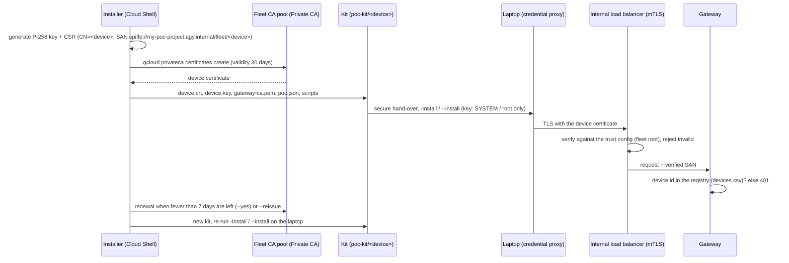

# POC technical reference

Details behind [POC-STEP-BY-STEP.md](POC-STEP-BY-STEP.md): what each step does, every file, check and name, and what to do when something fails. Use the step-by-step guide to run the POC; come here when you need the details. Checklists: [POC-PREREQUISITES.md](POC-PREREQUISITES.md), [POC-PERMISSIONS.md](POC-PERMISSIONS.md). How the parts work: [POC-HOW-IT-WORKS.md](POC-HOW-IT-WORKS.md); changing settings: [POC-CHANGING-SETTINGS.md](POC-CHANGING-SETTINGS.md).

| Section | Content |
|---|---|
| [1](#1-prerequisites-in-detail) | Preflight, network, laptops, `devices.csv` rules |
| [2](#2-cloud-permissions-in-detail) | Installer grant, billing role, IAM propagation, admin-laptop profile |
| [3](#3-gateway-deployment-what-gets-created) | Questions, installer phases, validation report, `--status` |
| [4](#4-certificates-and-kits) | Certificate life cycle, kit contents, kit verification, hand-over |
| [5](#5-endpoint-install-and-checks) | Windows and macOS options, all check ids, first sign-in |
| [6](#6-running-the-poc-saved-queries-attack-pack-enforce-evidence) | Saved queries, Logs Explorer, attack pack modes, enforce, evidence |
| [7](#7-certificate-operations) | Renew, add, block devices |
| [8](#8-sharing-the-evidence) / [9](#9-teardown-in-detail) | Sharing the evidence, teardown |
| [10](#10-troubleshooting) / [11](#11-known-poc-limits) / [12](#12-laptop-layer-profile) / [13](#13-security-notes) | Troubleshooting, limits, layer profile, security notes |

**Roles used below**

| Role | Does |
|---|---|
| Project admin | Owns the Google Cloud project; grants the installer role (§2) |
| Billing admin | Billing account administrator; grants the billing role (§2) |
| Installer | The (non-Owner) identity that runs `poc/poc-gateway.sh` (§3, §4, §7, §9) |
| Network team | VPN, routes, firewall (§1) |
| Endpoint IT | Local administrator on each laptop (§5, §6, §9) |
| POC user | Device owner, standard user (§5, §6) |

---

## 1. Prerequisites in detail

| # | Step | Who | Where | Success check |
|---|---|---|---|---|
| 0.1 | Clear the checklist in [POC-PREREQUISITES.md](POC-PREREQUISITES.md) (blockers first) | POC owner | — | All blockers ticked |
| 0.2 | Create a dedicated project (for example `my-poc-project`) and link the pay-as-you-go billing account | Project admin | Console | `gcloud billing projects describe my-poc-project` shows `billingEnabled: true` |
| 0.3 | Optional dry run of the read-only preflight (it also runs automatically in §3) | Installer | Cloud Shell | `READY` (see below) |
| 0.4 | Site-to-site VPN to the POC VPC, routes, firewall | Network team | Your network | `Test-NetConnection <gateway-ip> -Port 443` succeeds after §3 |
| 0.5 | Laptops: OS version, local administrator, owner is a standard user | Endpoint IT | Each laptop | See table below |
| 0.6 | Write `devices.csv` | POC owner | Cloud Shell | `python3 poc/poc_kit.py validate poc/devices.csv` prints no error |

**0.3 Preflight (read-only, changes nothing).** From the repository folder:

```bash
python3 install/preflight.py --project my-poc-project --region europe-west4 --zone europe-west4-a --mtls --no-evidence
```

It writes `preflight-report.md` and ends with `READY` or `BLOCKED (<n> blocking)`. Checks include: `gcloud auth`, `ADC (Terraform)`, `project`, `billing`, `region`, `zone`, `permissions` (every permission of the installer), and the organisation policies `gcp.resourceLocations`, `gcp.restrictServiceUsage`, `gcp.restrictNonCmekServices`, `compute.restrictLoadBalancerCreationForTypes`, `iam.allowedPolicyMemberDomains`, `run.allowedIngress`. Fix every ❌ item before §3. Run it after §2 if you want the permission check to pass.

**0.4 Network.**

| Item | Requirement |
|---|---|
| VPN | HA VPN + Cloud Router (BGP) to the POC VPC (created in §3, default subnet `10.40.0.0/24`; the gateway's internal IP comes from this subnet). The internal load balancer is regional and has no global access: terminate the VPN (or interconnect attachment) in the deployment region |
| Shared VPC | Instead of the new POC network, the gateway can take an IP from a subnet of your existing Shared VPC (question 7); with a connection that ends in another region, answer 7f = yes (global access). See [POC-SHARED-VPC.md](POC-SHARED-VPC.md) |
| Routes | On-premises learns `10.40.0.0/24`; remote workers' client VPN / ZTNA routes the gateway IP through the tunnel |
| Firewall | Your corporate firewall allows TCP 443 from the POC laptops to the gateway IP |
| TLS inspection | None on the path to the gateway (mTLS breaks) |
| DNS | Nothing to configure: the gateway name is `gateway.agy.internal` in a private Cloud DNS zone visible only inside the VPC; the endpoint scripts pin this name to the gateway IP in the laptop's hosts file (marker `# agy-poc-gw`) |
| Laptop egress at install | `storage.googleapis.com/antigravity-public` (Antigravity), Windows also `www.python.org` (Python 3.12) and `github.com` (Windows Terminal), and `download.sysinternals.com` only with `-Sysmon` |

**0.5 Laptops.**

| | Windows | macOS |
|---|---|---|
| OS | Windows 11 24H2 (build 26100) or later; the script refuses older builds and Windows Server (unless `-AllowServer`, lab only) | macOS 14 or later |
| Extra | — | Command Line Tools (`xcode-select --install`) so `/usr/bin/python3` (3.9+) works |
| Admin | A local administrator runs the script once | An administrator runs `sudo` once |
| Owner | Standard user (administrators are refused); signs in once before the install | Same |
| Antigravity | The script installs the pinned client (CLI and Desktop app) and Python 3.12 | The script installs the pinned CLI only (no Desktop app) |

**0.6 `devices.csv`.** Copy the example and edit it:

```bash
cp poc/devices.csv.example poc/devices.csv
```

```text
device,owner,persona,os
win-dev-01,developer1@example.com,dev,windows
win-ctr-01,contractor1@example.com,contractor,windows
mac-dev-01,developer2@example.com,dev,macos
```

| Column | Rule (checked by `poc_kit.py validate`) |
|---|---|
| Header | Exactly `device,owner,persona,os`; lines starting with `#` are ignored |
| `device` | A free label, unique: `^[a-z0-9][a-z0-9._-]{1,62}$` (2–63 characters). Recommended: the laptop's short host name in lowercase; a full name works up to 63 characters. It becomes the certificate identity (no DNS name in the certificate, no dependency on domain membership) |
| `owner` | An e-mail address (the identity the gateway logs for this device) |
| `persona` | `dev` or `contractor` |
| `os` | `windows` (Windows 11), `windows10` ([POC-WINDOWS-10.md](POC-WINDOWS-10.md)) or `macos`; anything else (for example `linux`) is rejected: Linux endpoints are not part of the POC yet |

---

## 2. Cloud permissions in detail

| # | Step | Who | Where | Duration |
|---|---|---|---|---|
| 1.1 | Grant the time-bound installer role | Project admin | Cloud Shell | 1 min |
| 1.2 | Grant Billing Account Costs Manager | Billing admin | Console | 1 min |
| 1.3 | Wait for IAM propagation | — | — | 2–5 min |
| 1.4 | Prepare the installer's `gcloud` session | Installer | Cloud Shell or admin laptop | 2 min |

**1.1** From the repository folder:

```bash
install/grant-installer.sh --project my-poc-project --principal user:installer@example.com --no-evidence
```

Creates the custom role `agyPocInstaller` (exact permissions: `install/permissions.txt`) with an expiry condition (default 8 hours; `--hours N` to change). `--no-evidence`: no organisation-level role (the POC uses prompt logging `hash`). Check: `install/installer_iam.py show --project my-poc-project --principal user:installer@example.com`.

**1.2** Console: **Billing → Account management** (of the billing account linked to the project) **→ Add principal** → `installer@example.com` → role **Billing Account Costs Manager**. Mandatory: budgets live on the billing account and can't be part of a project role.

**1.3** IAM changes take about 2–5 minutes and are intermittent at first (some calls pass, some return `403`). Wait before §3.

**1.4** In **Cloud Shell**, sign in as the installer; nothing else is needed. On an **admin laptop**, use a dedicated profile so your own `gcloud` configuration stays untouched:

```bash
export CLOUDSDK_CONFIG=$HOME/.agy-poc-installer
gcloud auth login installer@example.com
gcloud auth application-default login
export GOOGLE_APPLICATION_CREDENTIALS=$CLOUDSDK_CONFIG/application_default_credentials.json
```

If it fails: `403` on the first calls → wait (1.3); preflight `permissions FAIL` → the grant is missing or expired (repeat 1.1).

---

## 3. Gateway deployment: what gets created

| Who | Where | Prerequisites |
|---|---|---|
| Installer | Cloud Shell (or the admin laptop session from 1.4), in the extracted release or cloned repository folder | §2 done; `poc/devices.csv` written |

```bash
poc/poc-gateway.sh
```

| Question | Example answer |
|---|---|
| `1/6 GCP project ID for the POC` | `my-poc-project` |
| `2/6 Region (EU residency)` | `europe-west4` (default) |
| `3/6 Admin e-mail (operator, budget and security alerts; a group address is best)` | `agy-poc-admins@example.com` |
| `4/6 Monthly budget alert for developers (billing account currency)` | `2000` (default) |
| `5/6 Monthly budget alert for contractors (billing account currency)` | `1000` (default) |
| `6/6 Path to devices.csv (device,owner,persona,os)` | `poc/devices.csv` (default) |

The answers are saved in `poc/.state/answers.env` (no secrets). Then the script shows the estimated cost (internal load balancer + Private CA about EUR 60–80 / month; Cloud Run, KMS, Model Armor, logging, NAT about EUR 15–30 / month; Gemini calls pay per token) and asks `Proceed and accept these costs? (yes/no)`; type `yes` (asked once; later `--yes` runs reuse it).

**What it creates, in order** (the standard installer, profile `gateway`; phases as printed):

| Installer phase | Creates |
|---|---|
| Preflight | Read-only checks (§1 step 0.3); stops with `preflight found blocking issues - see preflight-report.md (nothing was changed)` |
| 2 remote state | KMS key ring and key, CMEK-encrypted Terraform state bucket |
| 3 foundation | APIs first, then the full Terraform configuration: KMS keys, VPC and subnet, Artifact Registry, Model Armor, logging buckets, sinks and alert policy, BigQuery SIEM (views `v_gateway_events`, `v_persona_usage`, …), per-persona budgets, the device registry from `devices.csv`, 5 shared Log Analytics saved queries (5.2), and the mTLS front door below |
| 4 gateway image | Cloud Build of the gateway container (immutable content-hash tag) |
| 5 gateway + mTLS front door | Apply with the gateway image, then wait (up to 30 minutes) until the gateway's server certificate is `ACTIVE`. Front door: Cloud Run gateway (internal ingress); Private CA pools (DevOps tier): **device** pool (root `AGY Device Root CA`, for Google Cloud workstations), **fleet** pool (root `AGY Fleet Device Root CA`, issues the POC laptop certificates, at most 30 days), **server** pool (root `AGY Internal Server Root CA`, the gateway's server certificate through Certificate Manager); Certificate Manager trust config (device and fleet roots); server TLS policy `REJECT_INVALID` (a valid client certificate is mandatory); regional internal Application Load Balancer with an internal IP; private DNS zone `agy.internal` with `gateway.agy.internal` |
| 7 validation | `install-report.md` |

Terraform apply is retried 3 times automatically. Typical time: about 25–30 minutes on a clean project, about 5 minutes on re-runs; the installer prints the elapsed minutes at the end (`AGY POC installed in my-poc-project (<n> min) - validation: PASSED`).

**Validation report (`install-report.md`).** Must end with `**Result: PASSED**`. Expected warnings in the POC:

| Check | Why it is a WARN in the POC |
|---|---|
| V91 / V92 | `no gateway call in the last 20 min` / `no inspected stream in the last 20 min`: no laptop has used the gateway yet |
| V95 | `not locked (LOG_LOCK_DAYS=0)`: log buckets aren't locked in the POC |
| S38 | `groups_mode = none`: users are mapped one by one through `devices.csv` |

The report's last line mentions `make fleet-cert` and `scripts/fleet-probe.sh`; `poc-gateway.sh` does the certificate step for you (§4).

**Status:**

```bash
poc/poc-gateway.sh --status
```

Shows `project`, `gateway` (`https://gateway.agy.internal -> <internal IP>`), `gateway service`, `registered devices`, the budgets of this project, and per device kit: `device | persona | os | owner | certificate` (`<n> days left`, `EXPIRED` or `no kit`).

If it fails: re-run `poc/poc-gateway.sh --yes` (idempotent; completed phases are skipped). A persistent `403` → §2 step 1.3. Preflight `BLOCKED` → fix the ❌ items in `preflight-report.md`.

---

## 4. Certificates and kits

`poc/poc-gateway.sh` continues automatically after the deployment. Nothing extra to run; this phase explains what happens and how to check it.



**3.1 Certificate issuance** (`scripts/fleet-cert.sh <device> --test-key --out poc/.state/certs --days 30`, called once per device):

| Item | Value |
|---|---|
| Key | ECDSA P-256, generated **on the installer machine** (`--test-key`); the script prints `WARNING: lab key generated on this machine. In production the key is created on the device (TPM / Secure Enclave) and only the CSR is sent.` |
| CSR | Subject `/O=AGY/CN=<device>`, SAN `URI:spiffe://<project>.agy.internal/fleet/<device>` |
| CA pool | The fleet pool (only certificates with exactly one such SAN are accepted) |
| Lifetime | 30 days in the POC (`CERT_DAYS`, 1–30) |
| When | Only when the certificate is missing or has fewer than 7 days left; `--reissue` re-issues all |
| Output | `poc/.state/certs/<device>.crt`, `<device>.key` (mode 0600), `gateway-ca.pem` (the gateway's server root); the CSR is deleted |
| Registration | The device is registered at the gateway from `devices.csv` before the certificates are issued; an unregistered device gets `401` |

**3.2 Kits** (`poc/poc_kit.py kit`), in `poc-kit/`:

| OS | Archives |
|---|---|
| Windows | `poc-kit/<device>.zip` (opens in Explorer) and `poc-kit/<device>.tar.gz` |
| macOS | `poc-kit/<device>.tar.gz` |

Each archive contains one folder `<device>/` (mode 0700, files 0600):

| File | Windows kit | macOS kit | Content |
|---|---|---|---|
| `README.txt` | ✓ | ✓ | The exact install / test / collect / remove commands |
| `poc.json` | ✓ | ✓ | `schema` (`agy-poc-kit/1`), `device_id`, `owner`, `persona`, `group`, `os`, `gateway` (`url`, `hostname`, `ip`, `pin_hosts`), `project`, `region`, `certificate` (`cert`, `key`, `gateway_ca`, `not_after`), `hook` (`critical: enforce`, `noisy: audit` or `enforce`, `audit_classes`), `client` (`version_policy: latest-tested`; Windows: CLI manifest and pinned Desktop build), `hosts_pin`, `layers` (`app_control: false`, `sysmon: false`, `egress_firewall: false`, `rdp: admins`), `generated` |
| `device.crt`, `device.key` | ✓ | ✓ | Device certificate and **private key** |
| `gateway-ca.pem` | ✓ | ✓ | Trust anchor for the gateway's server certificate |
| Endpoint script | `install-windows.ps1` | `install-macos.sh` | The POC script |
| Installer | `Install-AGYEndpoint.ps1` | — | Windows endpoint installer |
| `attack-pack/` | ✓ | ✓ | `runner.py`, `scenarios.json`, `repos/` (fixture projects), `README.md`; no results. For the live scenarios on the laptop (5.3) |
| `bundle/` | `bootstrap.ps1`, `files/` (controls, hook, policies, credential proxy) | `hooks/` (`agy-hook.py`, `policy.json`, `hooks.json`), `credproxy/agy-credproxy.py`, `policies/` (`admin_settings.json`, `agy-dev.settings.json`, `agy-contractor.settings.json`, `agy-dev.mcp_config.json`, `agy-contractor.mcp_config.json`) | Endpoint controls |

**3.3 Verify a kit before shipping** (Cloud Shell, in `poc-kit/<device>/`):

```bash
openssl x509 -in device.crt -noout -subject -enddate
openssl x509 -in device.crt -noout -text | grep -A1 "Subject Alternative Name"
openssl x509 -in device.crt -noout -pubkey | openssl sha256
openssl pkey -in device.key -pubout | openssl sha256
python3 -c 'import json; d=json.load(open("poc.json")); print(d["device_id"], d["persona"], d["os"], d["gateway"], d["hook"]["noisy"])'
```

Expected: subject with `CN = <device>`; `notAfter` about 30 days ahead; SAN `URI:spiffe://my-poc-project.agy.internal/fleet/<device>`; the two `sha256` values are identical (certificate and key match); `poc.json` shows the right device, persona and OS.

**3.4 Hand-over.** Each kit contains the device's private key: send it over a secure channel (for example an encrypted share with access for the endpoint IT admin only), never by e-mail. After the install (and after copying **only** its `attack-pack/` folder to the owner's profile / home for 5.3, never `device.key`), delete every copy (download folder, share, extracted folder on the laptop). The endpoint scripts copy what they need; they don't delete the extracted kit folder.

---

## 5. Endpoint install and checks

Prerequisite on every laptop: the owner has **signed in once**; the laptop reaches the gateway over the VPN (or use the offline option and test later).

### 4.1 Windows (per laptop, Endpoint IT, about 3–6 minutes, no reboot)

1. Copy `<device>.zip` to the laptop and extract it (Explorer → *Extract all*, or):
   ```powershell
   Expand-Archive -Path .\win-dev-01.zip -DestinationPath C:\AGYKit
   ```
2. Open **Terminal (Admin)** / PowerShell as administrator:
   ```powershell
   cd C:\AGYKit\win-dev-01
   Get-ChildItem -Recurse | Unblock-File
   powershell -ExecutionPolicy Bypass -File .\install-windows.ps1 -Install
   ```

| Option | Effect |
|---|---|
| (none) | Proposes the user signed in at the console: `Device owner: <user> (kit owner: <owner>) - correct? (y/n)` |
| `-User <account>` | Owner account: `DOMAIN\user`, `AzureAD\user@corp` or a local user |
| `-Yes` | Accept the proposed owner without asking |
| `-Offline` | Skip the gateway reachability check (P02 fails until the laptop is on the VPN) |
| `-AppControl` | Also AppLocker per persona group + WDAC in audit |
| `-Sysmon` | Also Sysmon |
| `-AllowServer` | Windows Server, lab simulation only (no terminal sandbox) |

What the script does: checks the build and the owner (`'<user>' is a local administrator - POC users must be standard users` if not), checks TCP 443 to the gateway IP, writes the hosts entry, installs the device certificate to `C:\ProgramData\Antigravity\credproxy\` (`device.crt`, `device.key`, `root.pem`; the folder is readable by SYSTEM and Administrators only), adds the owner to `AGY-Dev` or `AGY-Contractor`, runs the endpoint installer (Python, client, controls), restarts `AGY-CredProxy`, prints `installed in <n> min (target < 10, no reboot); running the self-test`, then the self-test. Finally: `Ask <user> to sign out and in once`.

3. Self-test (also after every change):
   ```powershell
   powershell -ExecutionPolicy Bypass -File .\install-windows.ps1 -Test
   ```

| Check | Meaning | Expected |
|---|---|---|
| P01 | Gateway name resolves to the internal address (hosts entry) | PASS |
| P02 | Device certificate accepted by the gateway front door (mTLS) | PASS (FAIL while offline) |
| P03 | Device owner is a standard user in the persona group | PASS |
| P04 | Install time under 10 minutes, no reboot | PASS (WARN if slower) |
| P05 | Device certificate valid | PASS (WARN < 7 days, FAIL expired) |
| P06 | Remote Desktop for Administrators only (persona groups denied) | PASS |
| P00 | Only when not installed: no leftovers | PASS after uninstall |
| V71 | Terminal sandbox | WARN until the owner has started `agy` once, then PASS |
| V72, V74, V75 | AppLocker, WDAC, WSL / Docker rules | SKIP (application control off) unless `-AppControl` |
| V73 | Build layout | PASS |
| V76 | Package proxy | WARN (no package proxy in the POC) |
| V77 | Sysmon | SKIP unless `-Sysmon` |
| V78 | Launcher shim first on PATH, review-bypass guard | PASS |
| V79, V80 | UAC auto-deny for standard users, Windows sudo off | PASS |
| V81 | Administrator protection | PASS, or WARN where not supported |
| V83 | Pre-provisioned items | PASS |
| V84 | Antigravity version on target | PASS (WARN until the policy task has run) |
| V86 | Persona source | PASS |
| V87 | Credential proxy refuses non-personas; device certificate valid, key ACL | PASS |
| V98, V99, V100 | Telemetry / device-identity packages, EDR service | SKIP (not used in the POC) |

The result is saved in `C:\ProgramData\AntigravityPOC\test.json`. `Test-AGYEndpoint.ps1 -Only V87` re-runs single V-checks.

### 4.2 macOS (per Mac, Endpoint IT)

```bash
tar -xzf mac-dev-01.tar.gz
cd mac-dev-01
sudo bash install-macos.sh --install
```

| Option | Effect |
|---|---|
| (none) | Proposes the console user as device owner and asks for confirmation |
| `--user <short name>` | Owner account |
| `--yes` | Accept the proposed owner without asking |
| `--offline` | Skip the gateway reachability check (M11 fails until the Mac is on the VPN) |

The device certificate goes to `/Library/Application Support/Antigravity/credproxy/` (`device.key` and `device.crt` `root:wheel` 600, folder 700). Self-test:

```bash
sudo bash install-macos.sh --test
```

| Check | Meaning |
|---|---|
| M01 | Admin settings locked, gateway via local proxy |
| M02 | Corporate hook and policy installed, root-owned, immutable |
| M03 | User's managed files locked (settings, hooks, MCP, browser allowlist; `~/.gemini` immutable) |
| M04 | Credential proxy running and refusing non-personas |
| M05 | Device key readable by root only |
| M06 | Drift repair daemon loaded (every 5 min) |
| M07 | Gateway name resolves to the internal address |
| M08 | Device owner is a standard user in the persona group |
| M09 | Pinned Antigravity CLI and managed launcher |
| M10 | Python for the hook and proxy |
| M11 | Device certificate accepted by the gateway front door (mTLS) |
| M12 | Device certificate valid (WARN < 7 days) |
| M13 | Install time under 10 minutes, no reboot |
| P00 | Only when not installed: no leftovers |

All PASS expected (M11 FAIL while offline).

### 4.3 First sign-in of the user

After the install the owner signs out and in once. In the first minute after the first sign-in the agent may answer `AGY policy not applied yet for this user - it applies within a minute of sign-in; try again` (`503`): the credential proxy waits until the user's locked settings and hooks are in place and starts the policy run itself. Retry after a minute. Then the user follows [POC-USER-GUIDE.md](POC-USER-GUIDE.md).

---

## 6. Running the POC: saved queries, attack pack, enforce, evidence

| # | Step | Who | Where | When |
|---|---|---|---|---|
| 5.1 | Week 1 in audit mode | — | — | Days 1–5 |
| 5.2 | Daily checks | Installer, POC owner | Cloud Shell, BigQuery | Daily |
| 5.3 | Attack pack | POC owner, Endpoint IT | Cloud Shell and laptops | Week 1–2 |
| 5.4 | Switch to enforce | Installer, Endpoint IT | Cloud Shell, each laptop | After week 1 |
| 5.5 | Collect evidence | Endpoint IT | Each laptop | End of POC |

**5.1 Week 1.** Kits start with the hook classes `destructive`, `workspace_commands` and `workspace_write` in audit: matches are logged as `AUDIT_ALLOW` and allowed. All other classes are always enforced.

**5.2 Daily checks.**

```bash
poc/poc-gateway.sh --status
```

BigQuery (dataset `agy_siem`):

```sql
-- blocked / masked prompts and routing, last 24 hours
SELECT ts, event, user, policy_group, model, incident
FROM `my-poc-project.agy_siem.v_gateway_events`
WHERE ts >= TIMESTAMP_SUB(CURRENT_TIMESTAMP(), INTERVAL 1 DAY)
ORDER BY ts DESC;

-- usage and estimated cost per persona and device
SELECT day, persona, device, model, calls, input_tokens, output_tokens, est_cost_usd
FROM `my-poc-project.agy_siem.v_persona_usage`
ORDER BY day DESC;
```

Saved queries (shared, created by the POC): **Cloud console → Logging → Log Analytics → Saved queries (Shared)**. They query the security log bucket's `_AllLogs` view (gateway events are excluded from `_Default`):

| Saved query | Display name |
|---|---|
| `<prefix>-blocked` | AGY - blocked or flagged prompts and responses |
| `<prefix>-masked` | AGY - sensitive data masked before the model or in the answer |
| `<prefix>-devices` | AGY - rejected devices (unregistered or invalid certificate) |
| `<prefix>-routing` | AGY - model routing per persona (downgrades: reason not_authorized->tier) |
| `<prefix>-usage` | AGY - token usage per persona, user and device (last 7 days) |

(`<prefix>` = `agy` by default.) Alternative in Logs Explorer, with the scope including the `agy-security` bucket (**Refine scope → Scope by storage**):

```text
jsonPayload.component="agy-gateway" AND jsonPayload.event=("PROMPT_BLOCKED" OR "PROMPT_FLAGGED")
jsonPayload.component="agy-gateway" AND jsonPayload.event="DEVICE_REJECTED"
```

Budget and security alerts go to the admin e-mail from question 3.

**5.3 Attack pack** (`poc/attack-pack`, details in its `README.md`).

**Cloud-side simulation** of the hook rules, in Cloud Shell from the repository folder (no laptop needed; `--os windows` evaluates the Windows policy, `--os linux` the Linux / macOS policy; this is not a Linux laptop):

```bash
cd poc/attack-pack
python3 runner.py run --mode deterministic --os windows --persona dev        --out results/
python3 runner.py run --mode deterministic --os windows --persona contractor --out results/
python3 runner.py run --mode deterministic --os linux   --persona dev        --out results/
python3 runner.py run --mode deterministic --os linux   --persona contractor --out results/
python3 runner.py report --in results/
```

Each line prints `PASS|FAIL <id> <persona> <os> expected=… observed=…`; the report prints `critical blocked <x>%, blocked or flagged <y>%, false blocks <n>` and writes `results/attack-report.md`. Expected: critical 100 %, blocked or flagged ≥ 95 %, the control scenarios A26–A28 `allow`. OS, tamper and proxy scenarios are `manual` here.

**On the laptop**, from the `attack-pack/` folder of the kit, copied to the owner's profile / home before the kit was deleted (3.4). Run as the **owner** (standard user).

Live run with the agent (the commands from the kit's `README.txt`; it prints the prompts, fixtures and evidence to record):

```powershell
# Windows
cd attack-pack; & "C:\Program Files\Python312\python.exe" runner.py run --mode live --os windows --persona dev --out results\
```

```bash
# macOS
cd attack-pack && /usr/bin/python3 runner.py run --mode live --os macos --persona dev --out results/
```

Stage the fixture projects first if the prompts use them: `runner.py fixtures --stage <folder>` (copies `repos/`, `dotenv.fixture` → `.env`). Record the results in `live.json` and re-run with `--live-results live.json` (format in the attack-pack `README.md`).

Optional deterministic run on the laptop against the installed hook, with `--execute-os` for the OS / tamper / proxy checks:

```bash
# macOS
python3 runner.py run --mode deterministic --os macos --persona dev --execute-os --keep-session-guard \
  --hook /usr/local/libexec/agy-hook --policy "/Library/Application Support/Antigravity/hooks/policy.json" --out results/
```

```powershell
# Windows (Python installed by the POC)
& "C:\Program Files\Python312\python.exe" runner.py run --mode deterministic --os windows --persona dev --execute-os --keep-session-guard `
  --hook C:\ProgramData\Antigravity\hooks\agy-hook.py --policy C:\ProgramData\Antigravity\hooks\policy.json --out results\
```

Scenario A25 (local proxy called by a non-persona user) must be run as a local user who is in neither persona group (`agy-dev` / `agy-contractor`, Windows `AGY-Dev` / `AGY-Contractor`). Gateway scenarios (A15–A18, A24) need the prompts sent through the agent and the responses imported with `--gateway-results gw.json` (format in the attack-pack `README.md`).

**5.4 Switch to enforce.** In Cloud Shell:

```bash
HOOK_NOISY=enforce poc/poc-gateway.sh --yes
```

This rewrites every kit with `"noisy": "enforce"` (no new certificates unless due). Then re-run the install on each laptop with the new kit (§5: Windows step 2, macOS install command), and `-Test` / `--test`. Keep `HOOK_NOISY=enforce` on **every** later `--yes` run: without it, new kits are written in audit mode again.

**5.5 Evidence on each laptop.**

```powershell
powershell -ExecutionPolicy Bypass -File .\install-windows.ps1 -Collect
```

```bash
sudo bash install-macos.sh --collect
```

Output: `C:\ProgramData\AntigravityPOC\collect-<device>-<timestamp>.zip` (Administrators only) / `/Library/Application Support/AntigravityPOC/collect-<device>-<timestamp>.tar.gz` (root only): AGY events, self-test output, proxy and CLI logs, install record, hook policy; no keys. Send them to the POC team.

---

## 7. Certificate operations

| Task | Commands | Then on the laptop |
|---|---|---|
| Monitor expiry | `poc/poc-gateway.sh --status` (`<n> days left`); P05 / M12 on the laptop warn below 7 days | — |
| Renew (fewer than 7 days left) | `HOOK_NOISY=enforce poc/poc-gateway.sh --yes` (omit `HOOK_NOISY=enforce` during week 1) | Re-run `-Install` / `--install` with the new kit; P05 / M12 PASS |
| Renew all now | `poc/poc-gateway.sh --yes --reissue` | Same, on every laptop |
| Add a device | Add a row to `poc/devices.csv`, then `poc/poc-gateway.sh --yes` | §5 with the new kit |
| Block a lost or stolen device | Remove its row from `poc/devices.csv`, then `poc/poc-gateway.sh --yes` | — (the gateway now answers `401` `Unmanaged device (fleet_device_unregistered). Incident <id>.`; event `DEVICE_REJECTED`) |

Notes on blocking: the certificate itself stays valid until it expires (no revocation list in the POC); the block works because the gateway accepts only registered devices. Delete the old kit folder `poc-kit/<device>` and `poc/.state/certs/<device>.*` by hand. An expired certificate is rejected by the load balancer in the TLS handshake.

---

## 8. Sharing the evidence

Share with your Google contact: the `-Collect` / `--collect` files of each laptop, the `attack-report.md` files, the results of the saved queries (blocked prompts, masked data, rejected devices, routing, token usage), `v_persona_usage` for cost per persona, false-block reports from users, and install and uninstall times (P04 / M13). The evaluation and decision are done together, outside this repository.

## 9. Teardown in detail

| # | Step | Who | Where | Success check |
|---|---|---|---|---|
| 8.1 | Uninstall each laptop | Endpoint IT | Each laptop | P00 `PASS` |
| 8.2 | Remove the cloud resources, kits and keys | Installer | Cloud Shell | `--destroy` completes |
| 8.3 | Revoke the installer role | Project admin | Cloud Shell | `installer_iam.py show` shows no grant |
| 8.4 | Remove the billing role | Billing admin | Console | Principal removed |
| 8.5 | Remove the VPN | Network team | Your network | — |

**8.1**

```powershell
powershell -ExecutionPolicy Bypass -File .\install-windows.ps1 -Uninstall
```

Windows: removes the controls, tasks, client, persona groups (`AGY-Dev`, `AGY-Contractor`, `AGY-NoContainers`, `AGY-ContainerDev`), hosts entries, and `C:\ProgramData\Antigravity` including the device key (the top-level logs are archived first to `C:\ProgramData\AntigravityRemoved\<timestamp>`); resets the AppLocker collections when they hold AGY rules; removes Sysmon only if the POC installed it. Kept: Python, workspaces under `C:\projects`, the OS hardening baseline, evidence in `C:\ProgramData\AntigravityPOC`. Then runs `-Test` (P00).

```bash
sudo bash install-macos.sh --uninstall
```

macOS: removes the LaunchDaemons, the locks and managed files in the user's `~/.gemini` (the user's own files stay), `/Library/Application Support/Antigravity` including the device key, the hook, launcher and CLI, the hosts entries and the groups `agy-dev` / `agy-contractor`; logs move to `/Library/Logs/Antigravity/removed-<timestamp>`; evidence stays in `/Library/Application Support/AntigravityPOC`. Then runs `--test` (P00).

Delete any remaining copy of the kit on the laptop.

**8.2**

```bash
poc/poc-gateway.sh --destroy
```

Runs the installer's destroy (it asks for its own confirmation), then asks `Also delete the device kits and keys (poc-kit/, poc/.state/certs)? (yes/no)`; `yes` shreds the keys and removes the kits and the device registry file.

**8.3**

```bash
install/revoke-installer.sh --project my-poc-project --principal user:installer@example.com
```

(The grant also expires on its own, default 8 hours after it was given.) If you used a dedicated profile on an admin laptop: `rm -rf $HOME/.agy-poc-installer`.

**8.4** Console: **Billing → Account management** → remove `installer@example.com` (Billing Account Costs Manager).

---

## 10. Troubleshooting

| Symptom | Cause | Fix |
|---|---|---|
| `403` from Google APIs right after the grant | IAM propagation (intermittent for a few minutes) | Wait 2–5 minutes; re-run `poc/poc-gateway.sh --yes` |
| `preflight found blocking issues - see preflight-report.md (nothing was changed)` | A ❌ item: permissions, billing, organisation policy, project | Fix the item, re-run |
| `costs not acknowledged yet: run once without --yes` | Costs never accepted | Run once without `--yes` |
| `gateway <ip>:443 not reachable - check the VPN / routing` | No route to the gateway | VPN, routes, firewall (§1 step 0.4), or `-Offline` / `--offline` and test later |
| P02 / M11 FAIL with a TLS error (for example certificate required, unknown CA, handshake failure) | No / wrong client certificate, TLS inspection on the path, or certificate expired | Check `device.crt` / `device.key` in the credential proxy folder, bypass TLS inspection, renew (§7) |
| `401` `Unmanaged device (fleet_device_unregistered)` | The device isn't in `devices.csv` (or was removed) | Add it and run `poc/poc-gateway.sh --yes` |
| `503` `AGY policy not applied yet for this user - it applies within a minute of sign-in; try again` | First minute after the first sign-in | Retry after a minute; persistent: Windows check task `AGY-Policy`; macOS `sudo launchctl kickstart -k system/com.google.agy.policy` |
| `server certificate not ACTIVE after 30 min` (§3) | The gateway's server certificate (Certificate Manager, issued by the server CA pool) isn't ready | `gcloud certificate-manager certificates describe agy-gw-server-srv --location europe-west4 --project my-poc-project`; re-run `poc/poc-gateway.sh --yes` |
| `network problem (often IPv6 from this machine), not permissions: run from Cloud Shell or switch IPv6 off` (underlying error `cannot assign requested address`) | The admin machine's network (often IPv6) | The installer retries automatically; run from Cloud Shell or switch IPv6 off |
| `terraform not found (run the install first, or poc/poc-gateway.sh --yes)`, or Terraform can't read its state | Not run from the repository folder, or before the installer's own Terraform (in `.tools/bin`) exists | Run from the repository root; re-run `poc/poc-gateway.sh --yes` |
| Cloud Storage service agent "does not exist" on a new project | The project's Storage service agent is still being created | Handled automatically: the installer creates it and retries for about 3 minutes, then stops with a clear message; re-running is safe |
| Certificate Manager / Private CA IAM error 400 right after the APIs were enabled on a new project | The new service agents aren't ready yet | Handled by the automatic retry; if it still stops, re-run `poc/poc-gateway.sh --yes` |
| Preflight `org policy run.managed.requireInvokerIam` FAIL | The policy is enforced on the project | [Project exception](#organisation-policy-runmanagedrequireinvokeriam) |
| P05 / M12 WARN or FAIL | Certificate expires within 7 days or has expired | §7 renew |
| `nobody is signed in at the console` | No owner signed in, no `-User` / `--user` | Let the owner sign in once, or pass the account |
| `… is a local administrator - POC users must be standard users` | Owner is an administrator | Use the owner's standard account |
| `Windows 11 24H2 (build 26100) or later required for the terminal sandbox` | Old Windows build | Update Windows |
| `/usr/bin/python3 not usable - install the Command Line Tools` | macOS without Command Line Tools | `xcode-select --install` |
| Users stay in PowerShell Constrained Language Mode after removing an older version | That version left AppLocker caches in force | Run `-Uninstall` from a current kit (resets every AppLocker collection when AGY rules are present) |
| `Device owner: … correct? (y/n)` answered `n` (`cancelled - pass -User <account> to choose the owner`) | Wrong proposed owner | Re-run with `-User <account>` / `--user <short name>` |

### Organisation policy `run.managed.requireInvokerIam`

**Why the preflight fails:** the gateway runs on Cloud Run behind the internal mTLS load balancer with the Cloud Run IAM invoker check turned off. The load balancer can't attach Google identity tokens, so with this policy enforced every laptop request would be refused. The gateway authenticates the laptops itself.

**Fix (a project exception; nothing else changes):** an **Organization Policy Administrator** (`roles/orgpolicy.policyAdmin`) runs:

```bash
cat > requireInvokerIam.yaml <<'YAML'
name: projects/my-poc-project/policies/run.managed.requireInvokerIam
spec:
  rules:
  - enforce: false
YAML
gcloud org-policies set-policy requireInvokerIam.yaml
```

Then re-run `poc/poc-gateway.sh --yes`.

**Controls that stay in place:** Cloud Run ingress is internal only; the internal load balancer requires a valid laptop certificate; the gateway only accepts requests carrying the load balancer's secret header; laptops must be in the device registry; no `allUsers` / `allAuthenticatedUsers` access.

**Undo after the POC:** `gcloud org-policies delete run.managed.requireInvokerIam --project my-poc-project`.

## 11. Known POC limits

| Limit | Impact | Workaround |
|---|---|---|
| No certificate-only refresh | Renewing a certificate or switching to enforce means re-running `-Install` / `--install` with the new kit (3–6 minutes) | Plan renewals before P05 / M12 warn (< 7 days); combine with the switch to enforce |
| Removing a device doesn't delete its files, and its certificate stays valid | The gateway answers `401` at once, but the old kit and certificate stay on the admin machine, and the certificate stays cryptographically valid until it expires (at most 30 days) | Delete `poc-kit/<device>.*` and `poc/.state/certs/<device>.*` by hand |
| The internal load balancer has no global access in the POC's own network | Clients must arrive in the deployment region | Terminate the VPN (or interconnect attachment) in the deployment region, or use a Shared VPC with question 7f = yes ([POC-SHARED-VPC.md](POC-SHARED-VPC.md)) |
| Fixed gateway name | `gateway.<internal domain>` (default `gateway.agy.internal`); it can't be set through the questions | Nothing to do: the endpoint scripts pin it in the hosts file |
| Cloud deploy time varies | About 25–30 minutes on a clean project, about 5 minutes on re-runs | The installer prints the measured minutes at the end |
| No firewall rule for client ranges | None is expected for an internal Application Load Balancer | Confirm during the first VPN test (P02 / M11 mTLS check) |
| Headless agent runs | Actions that need approval are auto-denied in headless runs | Run the agent interactively for the POC |
| Windows Server | No terminal sandbox: every agent command needs approval (`-AllowServer`, lab only) | Use Windows 11 24H2 or later |

## 12. Laptop layer profile

| Layer | POC laptop default |
|---|---|
| Locked admin settings (gateway through the local credential proxy), corporate hook, locked per-user settings / hooks / MCP configuration / browser allowlist, credential proxy with the device certificate, persona group, pinned client and managed launcher, terminal sandbox (Windows), policy readiness gate | Always on (must-haves) |
| AppLocker / WDAC, Sysmon (Windows) | Off (`-AppControl`, `-Sysmon` to add) |
| Egress allowlist firewall | Off |
| Remote Desktop | Administrators / SYSTEM only (`agy-rdp = admins`): remote support keeps working; personas denied |
| Hosts sinkholes for direct model endpoints and tunnel services | On: they force the gateway path and also affect other tools on the laptop that use those hosts |

Week 1: the hook classes `destructive`, `workspace_commands` and `workspace_write` are in audit (`AUDIT_ALLOW`); all other classes (secrets, protected paths, remote scripts, critical deletions, tools, review bypass, …) are always enforced.

## 13. Security notes

| POC behaviour | Risk | Production path |
|---|---|---|
| The device key is generated on the installer machine (`--test-key`) | The key exists outside the device | Key created on the device (TPM / Secure Enclave), only the CSR sent (`scripts/fleet-cert.sh <device> --csr device.csr`), or an enrolment flow |
| The kit contains the private key | A leaked kit is a usable device identity until it expires | Secure hand-over, delete after install; short lifetime (30 days); block by removing the device from `devices.csv` |
| A local administrator can read the device key (SYSTEM / Administrators, or root on macOS) | An administrator could copy the identity | Hardware-bound, non-exportable keys |
| No certificate revocation list | A removed device's certificate stays valid until expiry; only the registry blocks it | CA with revocation lists checked at the front door |
| Uninstall deletes the key file (no secure wipe) | Remnants on disk | Hardware-bound keys |
